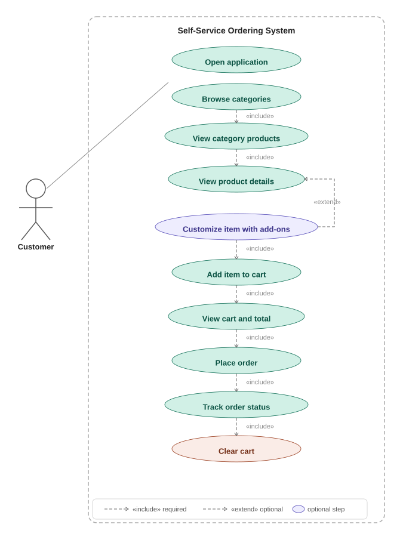
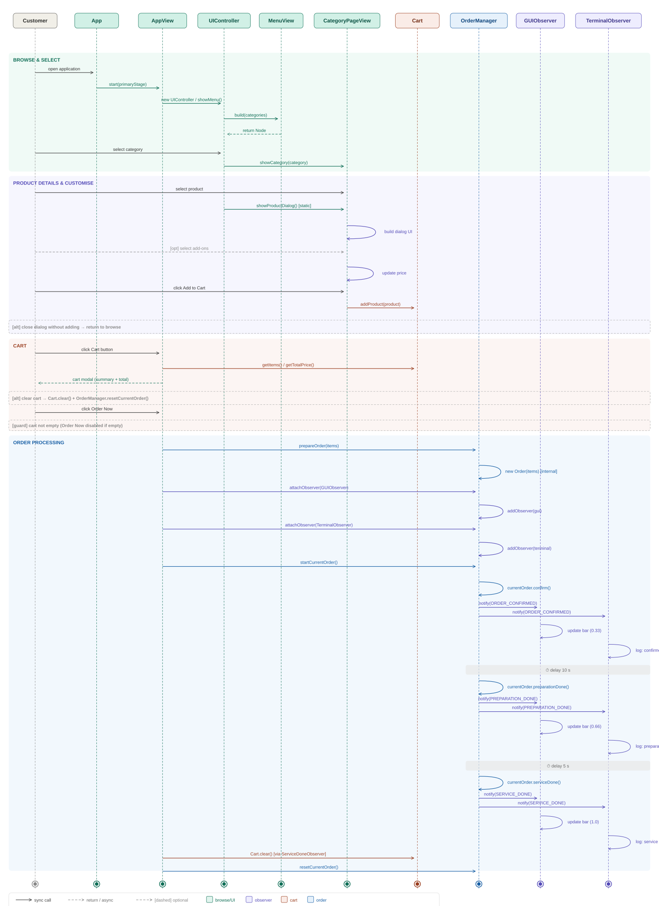

# Self-Service Ordering System

A JavaFX self-service ordering app for browsing menu categories, adding products to a cart, reviewing the order, and watching the order progress through confirmation, preparation, and service.

## Project Overview

This application is built around a simple in-memory ordering flow:

- Users browse menu categories and products.
- Users open a product page, choose add-ons where available, and add items to the cart.
- The cart modal shows the selected items and total price.
- Pressing **Order Now** starts an order progress flow that updates the UI through several statuses.
- When the order is completed, the cart is cleared and the app returns to a ready state.

## System Diagrams

### Use Case Diagram



### UML Class Diagram



### Sequence Diagram



## Main Features

- Category-based menu browsing
- Product cards and product detail dialogs
- Cart modal with order summary
- Add-on selection for eligible products
- Order progress updates using the observer pattern
- Clean JavaFX UI styling with CSS

## Tech Stack

- Java 21
- JavaFX 20
- Maven / mvnd
- Observer-based order status updates

## Project Structure

- `src/main/java/com/app/App.java` - JavaFX entry point
- `src/main/java/com/app/view/` - UI screens, dialogs, and cart modal
- `src/main/java/com/app/model/` - cart, order, menu, and product logic
- `src/main/java/com/app/model/observer/` - order observers and progress events
- `src/main/java/com/app/model/product/` - product hierarchy and decorators

## How To Run

From the Maven module folder:

```bash
cd "SelfSeviceOrderingSystem"
mvnd javafx:run
```

If you prefer Maven:

```bash
mvn javafx:run
```

## Installation

Before running the project from a fresh clone, make sure the computer has:

- Java 21 installed
- Maven or mvnd installed
- Internet access for the first build so dependencies can be downloaded

To check your Java version:

```bash
java -version
```

To check mvnd:

```bash
mvnd -v
```

If the version is not Java 21, install Java 21 and point `JAVA_HOME` to it before running the app.

## What You Need On Another Computer

If you pull the project from GitHub and run it from source, the other computer needs:

- Java 21 installed
- Maven or mvnd installed
- Internet access the first time so Maven can download dependencies

This project uses platform-specific JavaFX binaries through Maven profiles:

- macOS uses the `mac` JavaFX classifier
- Windows uses the `win` JavaFX classifier
- Linux uses the `linux` JavaFX classifier

That means the source can run on macOS, Windows, and Linux, as long as each machine uses Java 21 and builds with Maven/mvnd.

## Important Note About Runtime Compatibility

The app no longer requires JMetro. Runtime compatibility depends on Java and JavaFX only. If the computer has an older or different Java version, the app may fail to start.

For the most reliable cross-computer setup:

- Use Java 21 on both machines
- Run the project with Maven or mvnd
- Let Maven resolve the correct JavaFX platform libraries automatically

## If You Want A Standalone App

If you want the app to run without installing Java on the other computer, package it with `jpackage` and build a separate package for each operating system.

- macOS package for macOS
- Windows package for Windows

A packaged app is the best option if you want to share it with someone who should not need to install Java manually.

### Example `jpackage` flow

1. Build the app first:

```bash
mvnd clean package
```

2. Create an app image or installer with `jpackage` for the target platform.

3. Share that installer or app image with the other computer. If the package was built for macOS, it runs on macOS. If it was built for Windows, it runs on Windows.

The important rule is that you need a separate package for each operating system.
